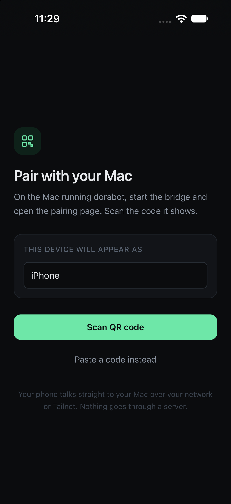
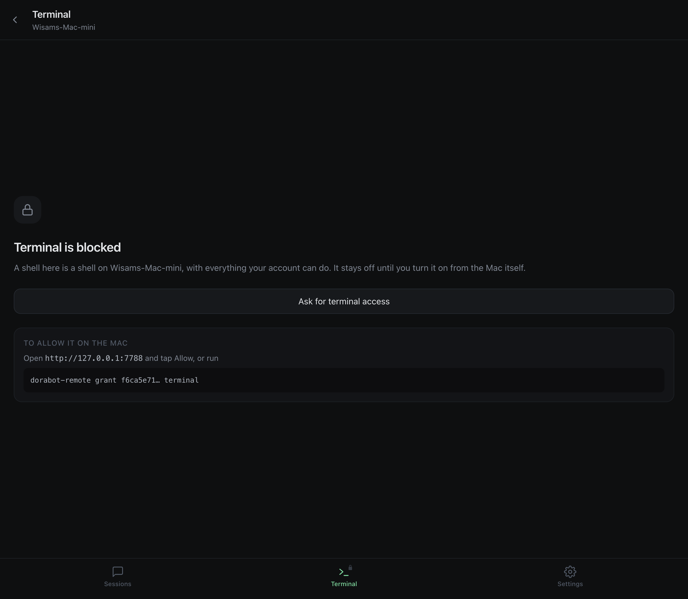

# dorabot remote

Pair your phone with your own [dorabot](https://github.com/suitedaces/dorabot) and
run real work from it.

Approve the tool calls it is blocked on, answer the questions it asks, read the
stream as it happens, send a new prompt, and open a shell if you let it. Your
phone talks **directly** to your own Mac over your network or your Tailnet. There
is no server in the middle, no account, and nothing to sign up for.

<p align="center">
  
  
</p>

---

## Why this exists

dorabot runs on a Mac and only talks over a unix socket (`~/.dorabot/gateway.sock`,
mode 0600). That is a sound default: the boundary is filesystem permissions, and
nothing is listening on a port.

The cost is that when dorabot blocks waiting for you to approve a command, it
blocks until you are physically back at that Mac. A tool approval has **no server
side timeout at all** — the agent waits forever. A question gets five minutes and
then fails the whole turn.

This project adds a small daemon beside dorabot that lets a phone you have
explicitly paired answer those prompts, without changing a line of dorabot itself.

## How it fits together

```
  iPhone / Android                    your Mac
  ┌────────────────┐                  ┌──────────────────────────────────┐
  │  dorabot app   │                  │  dorabot-remote bridge           │
  │  (Capacitor)   │ ══ encrypted ══▶ │   · one WS to the gateway        │
  │                │    ws:// over    │   · owns the 10s heartbeat       │
  │                │    LAN/Tailnet   │   · durable event log (SQLite)   │
  └────────────────┘                  │   · per-device permissions       │
                                      │   · scopes terminal output       │
                                      └────────────┬─────────────────────┘
                                                   │ unix socket, 0600
                                      ┌────────────▼─────────────────────┐
                                      │  dorabot gateway  (unmodified)   │
                                      └──────────────────────────────────┘
```

The bridge is a **sidecar**. It installs separately, reads dorabot's socket and
token like any other local client, and needs no patch, fork or plugin. dorabot can
update underneath it.

## Install

Needs Node 22.5 or newer, and dorabot already set up on the same machine.

```bash
git clone https://github.com/wisamamid/dorabot-remote
cd dorabot-remote
npm install
npm run build
```

Start the bridge:

```bash
npm run bridge
# or, once linked:  dorabot-remote start --open
```

It prints the addresses your phone can reach the Mac on and opens a control page
at `http://127.0.0.1:7788`. That page is bound to loopback only — the LAN can
reach the pairing and connection sockets, never the control surface.

## Pairing

Click **Show pairing code** on the control page, or run `dorabot-remote pair` to
get a QR straight in the terminal (handy over SSH).

Then either scan it with the app, or scan it with the phone's own Camera app:
the QR encodes a `dorabot-remote://pair#…` link, so iOS offers to open the app
directly.

Codes are **single use** and expire after five minutes.

### What pairing actually does

The QR carries the host's long term X25519 public key. The phone seals its
pairing request to that key with an anonymous sealed box, so the code never
appears in plaintext on the network and a machine-in-the-middle cannot pose as
your Mac. The phone generates its own keypair and the host stores only the public
half. **The dorabot gateway token never leaves the Mac.**

## Working from anywhere

The QR lists every address the Mac is reachable on — each LAN IP, the `.local`
name, and any Tailscale address — and the app races them all on every connect.

So "same wifi" and "anywhere over Tailscale" are the same code path. Walk out of
the house with Tailscale on and the app re-races, finds the Tailnet address and
carries on. No mode switch, no re-pairing, no relay server.

If Tailscale assigns a MagicDNS name you would rather advertise:

```bash
dorabot-remote start --advertise my-mac.tail1234.ts.net:7788
```

## Permissions

The dorabot gateway has **no per-method authorisation**. Once a client
authenticates, all 178 RPC methods are reachable, including `shell.spawn`,
`fs.write`, `git.push` and `config.set`. Fine for a local Electron window; not
fine for a phone on the internet.

So the bridge imposes its own, as a strict allowlist. A device gets scopes, each
scope unlocks a named set of methods, and anything unmatched is refused with a
reason the app can show you.

| Scope | What it unlocks | Granted at pairing |
|---|---|:---:|
| `sessions` | List, open, rename, fork, abort | yes |
| `chat` | Send prompts, read history, answer questions | yes |
| `approvals` | Approve or deny tool calls | yes |
| `work` | Tasks, projects, research, schedule | yes |
| `files` | Read and browse files (read only) | no |
| `git` | Status, diffs, stage, commit, push | no |
| `terminal` | A real shell on the Mac | **no** |
| `admin` | Settings and device management | no |

A device can **ask** for a scope; it can never grant itself one. The request shows
up on the Mac's control page and on the CLI, and you approve it there:

```bash
dorabot-remote grant <deviceId> terminal
```

The app picks the new permission up live, without reconnecting.

Some methods are never forwarded under any scope, including every
`provider.auth.*` call and the channel login/logout methods. Those hand out or
destroy credentials and have no business being reachable from a phone.

## The terminal

Off by default, and the app says so plainly rather than hiding the feature.

This is not decoration. The gateway broadcasts `shell.data` to **every**
authenticated client, carrying a `shellId` but no session key — meaning the raw
byte stream of every terminal open on the machine, including ones you opened
yourself, with no filtering of any kind.

The bridge therefore:

- namespaces every shell a device spawns, so one device can never address
  another's shell (or one you opened on the Mac),
- drops `shell.data` for any shell the connection does not own, before it reaches
  the generic fan-out,
- kills a device's shells when it disconnects, rather than leaving them for the
  next connection to inherit.

There is a test that asserts a paired device never receives bytes from a terminal
it did not open.

## Security model, briefly

**Transport.** Every frame after the handshake is XChaCha20-Poly1305 with a per
stream random nonce prefix and a message counter, so a replayed or reordered
frame fails to open.

**Authentication is mutual and needs no shared secret on the wire:**

```
ss_eph    = X25519(my_ephemeral_sk, their_ephemeral_pk)
ss_static = X25519(my_static_sk,    their_static_pk)
master    = BLAKE2b-64(ss_eph ‖ ss_static ‖ transcript)
```

`ss_eph` gives forward secrecy, so stealing a long term key later does not decrypt
recorded traffic. `ss_static` gives mutual authentication, since an attacker with
only the public keys cannot compute it. If a device presents the wrong long term
key, the derived keys differ and its very first frame fails to decrypt — that
failure *is* the authentication.

**Why plain `ws://` and not TLS.** The bridge lives at an address that moves with
the user's network, so no certificate can be issued or pinned for it. Encryption
and authentication happen above the transport instead, with the host key delivered
out of band by the QR. Adding TLS on top would authenticate nothing extra.

**Revocation** is immediate: revoke on the control page or with
`dorabot-remote revoke <deviceId>` and any live connection is dropped.

**Known gap.** The device private key is currently in Capacitor Preferences
(UserDefaults on iOS), not the Keychain. Tracked, and worth closing before this is
installed anywhere you do not control.

## Offline and resume

dorabot deletes its own `stream_events` ten minutes after a run finishes, so a
phone that was in a tunnel for an hour would reconnect to nothing.

The bridge keeps its own SQLite log (a week by default) and replays from it in
paced chunks. That pacing matters for a second reason: the gateway's own replay
path does not check backpressure but its live broadcast path does, closing any
client over 2 MiB buffered — so asking it for a large replay gets you disconnected
by the very data you asked for. The bridge absorbs that.

## Commands

```
dorabot-remote start                 Run the bridge
dorabot-remote pair                  Print a pairing QR in the terminal
dorabot-remote devices               List paired devices
dorabot-remote grant <id> <scope>    Add a permission
dorabot-remote revoke <id>           Block a device, keep the record
dorabot-remote remove <id>           Delete it entirely
dorabot-remote addresses             Show reachable addresses
```

## Building the app

```bash
npm run dev -w @dorabot-remote/mobile     # web, for development
npm run ios -w @dorabot-remote/mobile     # open Xcode
npm run android -w @dorabot-remote/mobile # open Android Studio
```

The web build is a usable PWA on its own if you would rather not install anything.

## Layout

```
packages/
  protocol/   Crypto, wire types, scope policy, stream assembly, shared client.
              Pure, no platform APIs, so the same code runs in Node, a browser,
              a WebView and the tests.
  bridge/     The daemon. Gateway client, durable log, permissions, pairing,
              control page, CLI. Zero native dependencies (node:sqlite).
  mobile/     React + Vite + Tailwind + Capacitor. iOS and Android.
```

## Tests

```bash
npm test
```

Crypto tests cover the handshake, replay and reorder rejection, and impersonation
with a wrong long term key. The end to end tests run a real bridge on a real port
driven by the exact client the app ships, against a fake gateway, and cover
pairing reuse, scope refusal, terminal isolation, offline replay and late
subscribe backfill.

## Status

Works, and used daily against a real dorabot. Not yet on TestFlight.

Before installing somewhere you do not control: move the device key to the
Keychain, and read the permissions table above properly rather than granting
everything.

## Licence

MIT. See [LICENSE](LICENSE), and [NOTICE](NOTICE) for the parts derived from
dorabot.
